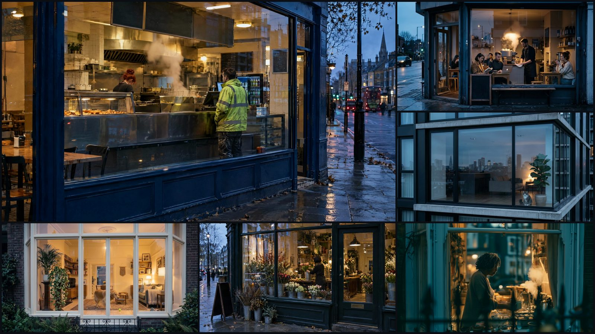
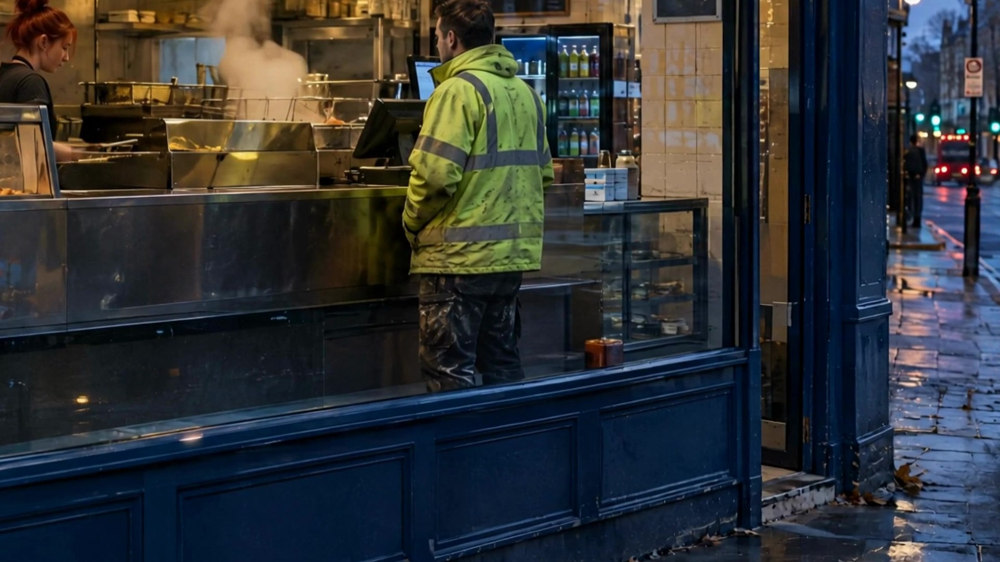
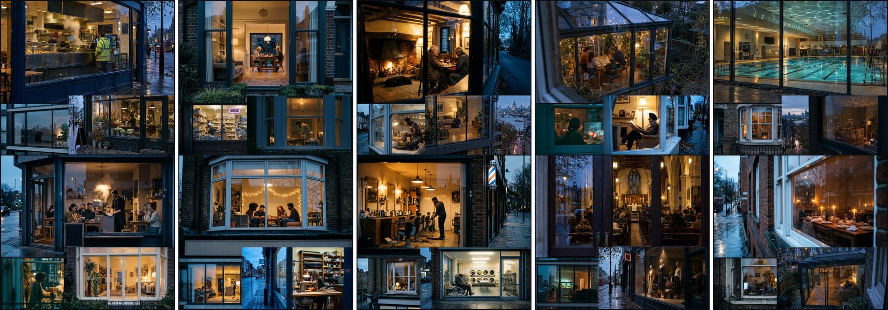
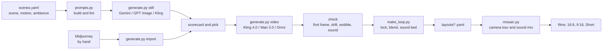

# Other People's Windows

[](LICENSE)
[](LICENSE)

> **Disclaimer.** This is a personal, non-commercial artistic research project maintained in a personal capacity. It is unrelated to and independent of my professional employment, generates no commercial revenue, and is not affiliated with any employer. **Every person and place in the work is AI-generated**; none of them exists.

<p align="center">
  
</p>

**Other People's Windows is a generative video artwork and an open investigation into how far today's image and video models can be directed.** Thirty windows into London homes, shops and halls on one autumn evening, from closing time to bedtime, are arranged as a facade. A slow virtual camera tours it, stops at each window, holds, and moves on. Each window is a short loop made from an AI still and an AI video take; the facade, the camera, the loops and the sound are built by the pipeline in this repository.

It is made for two audiences: people who want to watch the work, and people who want to see exactly how it was made, what each model got right and wrong, and what it cost.

- **Watch:** [the full film](https://youtu.be/0D90ZbpSdlI) (16:9, 4K, 5 min 11 s, three walls of ten windows), [the Short](https://youtube.com/shorts/P7SUlM5bvTk) (twelve windows, 2 min 14 s), the project page at <https://zenouz.ai/projects/other-peoples-windows/>, and the first six-window taster on [YouTube Shorts](https://youtube.com/shorts/1nh3fC1lH_o).
- **Read:** [`docs/FINDINGS.md`](docs/FINDINGS.md) for what the investigation found, [`docs/ARCHITECTURE.md`](docs/ARCHITECTURE.md) for how the pipeline works.

## What the work asks

Looking into lit windows at dusk is an old, slightly guilty pleasure: small lives framed and silent, nobody looking back. The project asks what happens when every one of those lives is synthetic. Can a model be held to the discipline the subject needs (people absorbed and turned away, no readable text, faint real sound, one slow continuous motion that loops), and does a city of invented strangers still feel like London?

The investigation is the making. Every window records the model, the prompt, the settings and the failures that came before it, so the finished film doubles as a dataset of how image and video models behaved in late 2026.

## Why it's worth a look

- 🎞️ **A finished artwork, not a demo.** Thirty windows: [a 16:9 4K film](https://youtu.be/0D90ZbpSdlI) on three walls of ten, a 9:16 version for phones on five pages and [a two-page Short](https://youtube.com/shorts/P7SUlM5bvTk).
- 🔬 **Every window is documented.** [`scenes/scenes.yaml`](scenes/scenes.yaml) holds each window's prompt parts, model, loop settings and notes on what went wrong, from a recast face to a church window no camera could see through.
- 📏 **Craft is measured, not guessed.** Camera drift, frame-to-frame wobble in pixels, first-frame fidelity against the still, loudness and AudioSet music and speech tags are computed for every take before it is kept.
- ⚖️ **Models compared on the same prompts.** A written shoot-out of Gemini, GPT Image and Midjourney for stills, and Veo 3.1, Gemini Omni, Kling 4.0 and Wan 3.0 for video, with the winners chosen on evidence.
- 💷 **Costs are on the record.** Every paid call is estimated before it is made and logged with its actual cost.
- 🔐 **Published the safe way.** The working repository stays private; this public one is an allowlisted, scanned export (see [Public and private publishing](#public-and-private-publishing)).

<p align="center">
  
</p>

## How a window is made

1. **Write.** A window is a few lines in `scenes/scenes.yaml`: the scene, the one slow motion, the faint ambience, and whether the room is empty. `pipeline/prompts.py` joins them with a shared house style and checks them against the rules (`lint`): no music, radio, voices or television in the sound, and so on.
2. **Still.** `pipeline/generate.py still` asks Gemini 3 Pro Image, GPT Image or Kling Image for candidates; Midjourney stills are made by hand and imported with a checksum check. Candidates are scored on a written scorecard (casting as described, faces turned away, no extra people, no readable text, sharp at full size) and one is picked.
3. **Take.** `generate.py video` animates the picked still as the first frame of a 10 second clip on Kling 4.0, Wan 3.0 or Gemini Omni, after a dry run that prints the cost.
4. **Check.** Each take is measured automatically: first frame against the still, camera drift, wobble, loudness, music and speech tags. A comparison sheet is written for judging casting by eye.
5. **Loop.** `pipeline/make_loop.py` trims the take, can hold the picture still (`--lock`) or remove a push-in (`--stabilize`), dissolves the end into the start over half a second, and replaces any unusable sound with a matching stretch from another clip (`--bed`).
6. **Place.** A layout in `layouts/` puts the loops on pages; `pipeline/mosaic.py` renders the camera tour, with sound that follows the camera.

## What's inside

| Part | What it does |
|---|---|
| `pipeline/prompts.py` | Builds full image and video prompts from `scenes.yaml`, lints them, writes batch briefs (Markdown and PDF), prints Midjourney prompts |
| `pipeline/generate.py` | Stills, edits and video takes through the Gemini, OpenAI, Kling and Alibaba Cloud Model Studio APIs; dry runs, per-command and per-batch budget caps, a spend ledger, take checks and scorecards |
| `pipeline/make_loop.py` | Raw clip to finished loop: stabilise or lock, trim, restart blend, sound bed, level |
| `pipeline/drift.py` | Camera drift (zoom and shift) and frame-to-frame wobble in px rms at 1080p |
| `pipeline/sound_check.py` | Loudness (LUFS) and AudioSet tags (PANNs CNN14); flags music, clear speech and loud loops |
| `pipeline/mosaic.py` | Renders the facade film from a layout: pages, overlaps, camera path, close-ups, sound mix; decodes only the windows near the camera |
| `pipeline/web_export.py` | The silent loop and poster for the project web page |
| `layouts/` | `facade-landscape-3x10.yaml` (16:9 film, three walls of ten), `facade-landscape.yaml` (the first 16:9 cut, five pages), `facade-pages.yaml` (9:16 film), `short-2pages.yaml` (the Short), `poster-6.yaml` (the first published poster) |
| `scenes/scenes.yaml` | The single source of truth: all 50 scenes written, 30 made, 20 cut, with prompts, settings and notes |

<p align="center">
  
</p>

## Findings in brief

The full write-up is in [`docs/FINDINGS.md`](docs/FINDINGS.md). The short version:

- **People belong to Kling 4.0.** It kept the still as the exact first frame, held the casting, and its camera barely moved (drift under 0.01% against 4 to 9% for Veo 3.1). Its own sound was unusable almost every time (music, speech, farmyard animals), so every Kling window carries a borrowed sound bed.
- **Empty rooms can go elsewhere, with care.** Wan 3.0 made the best empty nursery and the pool, but broke a rule on three of six shoot-out takes (a sign switching on, a softened face, a push-in). Gemini Omni repaints the still and trembles.
- **Stills: rules against looks.** GPT Image 2.5 followed the house rules best; Midjourney looked most photographic but put people large and in profile and needs upscaling; Gemini was sharpest but added pedestrians and readable signs.
- **Shake is a measurable defect.** Frame-to-frame tremble that a smooth stabiliser leaves in is what a close-up magnifies; locking every frame to the first one brought most shaky windows down to about 0.03 to 0.08 px rms (the pool from 0.66 to 0.08). Windows seen through glass with moving reflections improved less.
- **The rejected takes are the sound library.** The right ambience for a window was most often found in a take that failed for other reasons.

## Architecture



Details, data formats and the reasoning behind each stage: [`docs/ARCHITECTURE.md`](docs/ARCHITECTURE.md).

## Public and private publishing

This repository is a curated mirror. The working repository stays private, because it also holds production notes, personal planning and account details that do not belong in public. Publishing follows a small framework shared with other Zenouz projects:

1. **Allowlist.** Only paths listed in `public-export/manifest.txt` can be exported.
2. **Denylist.** `public-export/denylist.txt` removes anything sensitive even inside an allowed folder: keys, the spend ledger, assistant context, internal plans and logs.
3. **Replacements.** Public versions of the README and docs are written separately (`public-export/replacements/`) rather than copied from private notes.
4. **Scans.** The exported tree is scanned for private identifiers and secret patterns, and the private history for leaked keys; any hit blocks the publish.
5. **Fresh history.** The mirror is pushed as a single new commit by a neutral identity, so no private history ever reaches it.

```bash
python3 scripts/publish_public_mirror.py --output-dir /tmp/opw-public --scan-history          # build and check
python3 scripts/publish_public_mirror.py --output-dir /tmp/opw-public --scan-history --push   # publish
```

What is in and out, and why: [`docs/PUBLIC_REPO_SCOPE.md`](docs/PUBLIC_REPO_SCOPE.md).

## Run it

**Prerequisites:** Python 3.11, and API keys only if you want to generate new material. FFmpeg is used from your PATH, or from the `static-ffmpeg` package if none is installed.

```bash
python3.11 -m venv .venv && source .venv/bin/activate
pip install -r requirements.txt
pip install -r requirements-audio.txt            # optional: sound_check.py (about 1 GB)

python pipeline/prompts.py lint                  # check every window's prompts
python pipeline/prompts.py show 20               # the full prompts for one window
python pipeline/generate.py still 20 --dry-run   # what a still would cost, nothing spent
```

To generate, create a `.env` file (git-ignored) with your own keys for the services you use; the names are listed in [`docs/ARCHITECTURE.md`](docs/ARCHITECTURE.md#keys-and-costs). The clips themselves are not in this repository (they are large, and the artwork is not licensed for reuse), so `mosaic.py` and `make_loop.py` need your own loops in `media/`.

## Ethics and disclosure

- Every person and place is AI-generated, and every published film is labelled as altered or synthetic content.
- Casting is written to reflect London (age, ethnicity, body type, family shape) and checked on every still, because image models drift towards default faces.
- No real people, brands or readable signs: prompts require every sign, screen and label to be blank or unreadable.
- Scenes whose subject is music, or that would need words, are cut; the sound is faint ambience only.

## Documentation

- [`docs/FINDINGS.md`](docs/FINDINGS.md): what the investigation found, model by model.
- [`docs/ARCHITECTURE.md`](docs/ARCHITECTURE.md): the pipeline, its data and its checks.
- [`docs/PUBLIC_REPO_SCOPE.md`](docs/PUBLIC_REPO_SCOPE.md): the public and private boundary.
- [`docs/batch-04.md`](docs/batch-04.md), [`docs/batch-05.md`](docs/batch-05.md): generated batch briefs with every prompt; [`docs/batch-04-scorecard.md`](docs/batch-04-scorecard.md) and [`docs/batch-05-scorecard.md`](docs/batch-05-scorecard.md): the measured scorecards.

## License

The code is released under the [MIT License](LICENSE). The artwork (the films, stills and window texts) is © 2026 Kayvan Zenouz, all rights reserved. © 2026 Zenouz AI.
